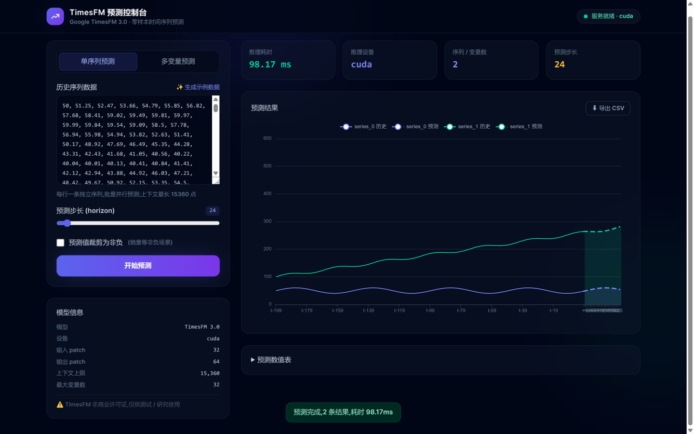
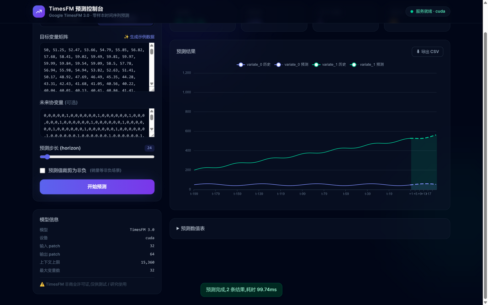

# TimesFM 3.0 时间序列预测服务

基于 FastAPI 封装的 [Google TimesFM 3.0](https://github.com/google-research/timesfm)(PyTorch 权重)零样本时间序列预测服务。

- 模型本地路径:`/home/feifei/develop/models/timesfm-3.0-pytorch`(可通过环境变量覆盖)
- 能力:批量单序列预测、多变量联合预测(≤32 变量)、协变量支持、9 档分位数区间(0.1~0.9)
- 设备:自动检测,优先 CUDA(RTX 5090 D 实测单次 24 步预测约 100ms)

## 界面预览

启动服务后访问 <http://127.0.0.1:8000/> 即可使用内置 Web 控制台:

**单序列批量预测** —— 历史曲线 + 虚线预测 + P10~P90 置信带:



**多变量联合预测** —— 变量矩阵 + 未来协变量:



## 目录结构

```
timesfm/
├── requirements.txt
├── server/
│   ├── main.py            # FastAPI 入口:lifespan 预加载模型、CORS、路由注册
│   ├── config.py          # 环境变量配置
│   ├── core/engine.py     # TimesFM 引擎单例:线程内加载、加锁串行推理、warmup
│   └── api/
│       ├── schemas.py     # Pydantic 请求/响应模型
│       ├── forecast.py    # 预测路由
│       └── system.py      # 健康检查与模型信息
└── examples/demo.py       # 调用示例(仅标准库)
```

## 安装与启动

提供了两个管理脚本:

```bash
./install.sh            # 安装依赖(幂等,可重复执行;优先用 uv,没有则回退 pip)
./server.sh start       # 后台启动服务,自动等待模型加载就绪
./server.sh status      # 查看运行状态与健康检查
./server.sh logs [行数] # 跟踪日志
./server.sh restart     # 重启
./server.sh stop        # 停止
```

端口/地址可用环境变量覆盖:`TIMESFM_PORT=8001 ./server.sh start`。日志写入 `logs/server.log`,PID 记录在 `.server.pid`。

手动方式(等价):

```bash
# 1. 创建虚拟环境并安装依赖(约 3~5 分钟,含 torch CUDA 版)
uv venv .venv --python 3.12
uv pip install --python .venv/bin/python -r requirements.txt

# 2. 前台启动服务(默认 0.0.0.0:8000)
.venv/bin/python -m server.main

# 3. 另开终端跑示例
.venv/bin/python examples/demo.py
```

交互式 API 文档:启动后访问 <http://127.0.0.1:8000/docs>

## Web 客户端

启动服务后直接访问 <http://127.0.0.1:8000/> 即可使用内置的预测控制台(Tailwind CSS + ECharts,本地 vendor 引入,无需外网):

- **单序列预测**:每行一条序列批量预测,支持 horizon 滑块、非负裁剪、示例数据一键生成
- **多变量预测**:目标变量矩阵 + 可选未来协变量
- **结果可视化**:历史曲线 + 虚线预测曲线 + P10~P90 置信带,统计卡片(耗时/设备/序列数)
- **导出**:预测数值表 + 一键导出 CSV(含全部 9 档分位数)

## 环境变量

| 变量 | 默认值 | 说明 |
|---|---|---|
| `TIMESFM_MODEL_PATH` | `/home/feifei/develop/models/timesfm-3.0-pytorch` | 模型目录(须含 config.json + model.safetensors) |
| `TIMESFM_DEVICE` | `auto` | `auto` / `cuda` / `cpu` |
| `TIMESFM_HOST` | `0.0.0.0` | 监听地址 |
| `TIMESFM_PORT` | `8000` | 监听端口 |
| `TIMESFM_BATCH_SIZE` | `8` | 单次前向批大小 |
| `TIMESFM_CORS_ORIGINS` | `http://localhost:3000,...` | CORS 允许来源,逗号分隔 |

## API 说明

### `GET /api/health`

```json
{"status": "ok", "model_ready": true, "device": "cuda", "error": null}
```

### `GET /api/model-info`

返回模型路径、分位数档位、patch 长度、上下文上限(15360)、最大变量数(32)等。

### `POST /api/forecast` — 批量单序列预测

各序列相互独立,内部走 `predict_batch`。单条序列可直接传一维数组,会自动包装。

```bash
curl -s http://127.0.0.1:8000/api/forecast -H 'Content-Type: application/json' -d '{
  "series": [[1.0, 2.2, 3.1, 4.5, 5.0, 4.8, 5.2, 6.0]],
  "horizon": 12,
  "quantile_levels": [0.1, 0.5, 0.9],
  "make_positive": false
}'
```

响应:

```json
{
  "results": [
    {
      "ts_id": "series_0",
      "point_forecast": [6.1, 6.3, "...共 horizon 个"],
      "quantiles": {"0.1": ["..."], "0.5": ["..."], "0.9": ["..."]}
    }
  ],
  "horizon": 12,
  "device": "cuda",
  "elapsed_ms": 45.2
}
```

请求字段:`series`(必填)、`horizon`(必填,≥1)、`ts_ids`(可选)、`return_quantiles`(默认 true)、`quantile_levels`(可选,必须是模型支持的 0.1~0.9 档位)、`make_positive`(上下文全为非负时把预测裁剪为非负,适合销量类)。

### `POST /api/forecast/multivariate` — 多变量联合预测

目标变量一起送入模型(variate attention 捕捉变量间关联),支持协变量。总通道数(目标变量 + 协变量)≤ 32。

```bash
curl -s http://127.0.0.1:8000/api/forecast/multivariate -H 'Content-Type: application/json' -d '{
  "targets": [[1.0, 2.0, 3.0], [2.0, 4.0, 6.0]],
  "horizon": 12,
  "past_only_covariates": null,
  "past_future_covariates": [[0,0,1,0,0,1, "...上下文长度+horizon 个"]]
}'
```

- `targets`:2D 矩阵,每行一个变量,行长一致
- `past_only_covariates`:仅历史已知的协变量,形状 `(n, 上下文长度)`
- `past_future_covariates`:历史与未来都已知(如节假日/周末标记),形状 `(n, 上下文长度 + horizon)`
- 响应按变量逐条返回,`ts_id` 为 `variate_0`、`variate_1`...

## 约束与注意事项

- **上下文长度**:最长 15360 点,超出自动截断保留最近数据;上下文太短(<32)精度会明显下降,建议尽量给足历史
- **预测步长**:无硬上限,内部按 64 步 patch 拼接;超过 128 步为跨 patch 拼接结果,精度建议自行验证
- **NaN 处理**:输入中的 NaN 会被模型内部线性插值;响应里的非有限值统一输出为 `null`
- **许可证**:TimesFM Non-Commercial License v1.0 —— 模型仅供**测试、评估、学术研究**等非商业用途,生产/商业使用需向 Google 申请商业授权
